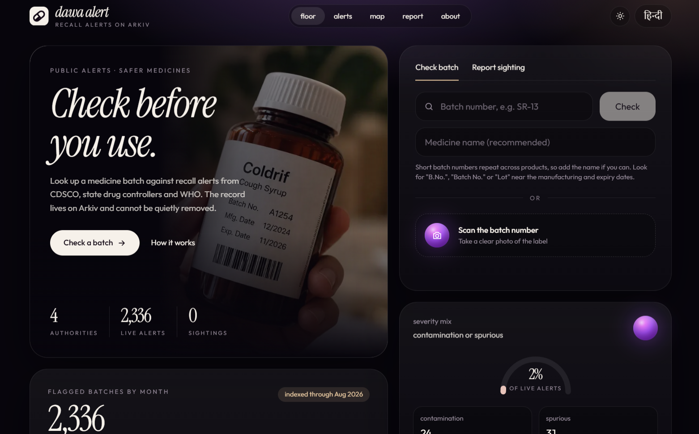
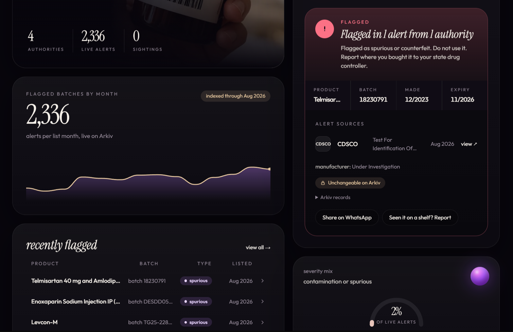
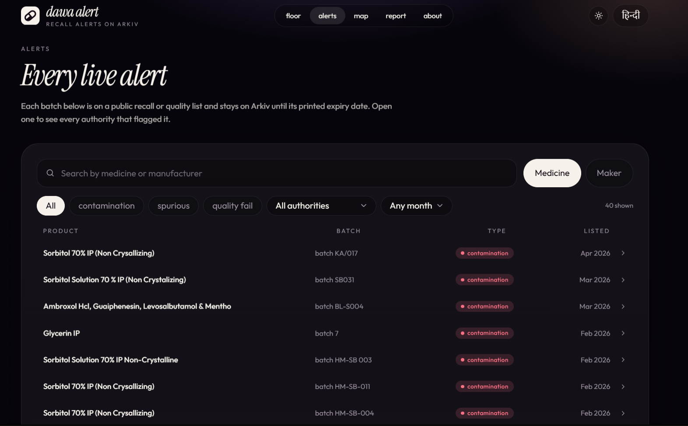
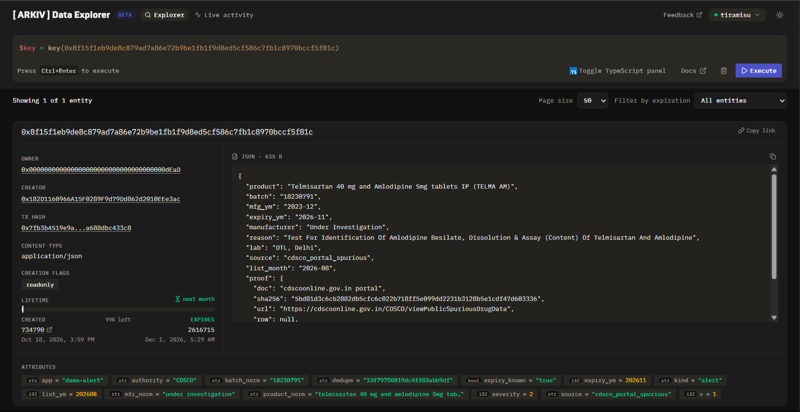

# Dawa Alert

**Is this medicine batch on a recall list?** Type or photograph the batch number and get an answer
in a second, from every official list we can find, with a record that nobody can quietly remove.

In October 2025, at least 24 children in Madhya Pradesh died after taking cough syrup contaminated with diethylene glycol (DEG).
CDSCO, state drug controllers and WHO each published their own notices, in different places and formats. CDSCO's own portal can be
searched by batch; what is missing is one record per batch that keeps **every authority's notice side by side, with its source and date,
cannot be quietly edited or removed, and lets people report where the batch has actually been seen**. That is what Dawa Alert adds.
It covers every batch on CDSCO's published NSQ and spurious lists that is still within its printed expiry (2,336 today), plus WHO's
alert for the three contaminated syrups and Telangana's stop-use notices.

**Live:** https://dawa-alert.vercel.app (Tiramisu testnet). Source data and the entities it reads are public; the relay wallet that
creates sightings is listed in [arkiv/schema.md](arkiv/schema.md).

## Screenshots



| | |
|---|---|
|  |  |
| **A flagged batch.** The verdict names the authority, the reason and the source, and marks the record "Unchangeable on Arkiv". | **Every live alert.** Browse and filter the full set by type, authority and month. |

The same record in the Arkiv data explorer: owner is the burn address, the entity is `readonly`, and it expires with the batch.



## Why this needs to exist

Contaminated or substandard medicine reaching children is not a one-off. The cases below are all documented in official notices,
and each one shows a different reason a single, source-linked, per-batch record is useful.

| Case | What the record shows | Why it matters for Dawa Alert |
|---|---|---|
| **Coldrif, Respifresh TR, ReLife** (India, 2025) | [WHO Alert N°5/2025](https://cdn.who.int/media/docs/default-source/substandard-and-falsified/n5_2025_syrup-medicines_en.pdf) names three batches with DEG: Coldrif `SR-13` (48.6% w/v), Respifresh TR `R01GL2523` (1.34%), ReLife `LSL25160` (0.61%). Telangana's drug controller issued a stop-use notice on 4 Oct; WHO's alert followed on 13 Oct. | The same batch was flagged by a state lab, a state controller and WHO on different dates. Dawa Alert keeps all three, each with its own source link: scan `SR-13` and you see them together. This is our live demo batch. |
| **COLDBEST-PC syrup** (J&K, 2019-20) | CDSCO's [March 2020 drug alert](https://cdsco.mohfw.gov.in/opencms/resources/UploadCDSCOWeb/2018/UploadAlertsFiles/A%20list%20for%20Drugs%20alert%20March%202020.pdf) lists COLDBEST-PC from Digital Vision (Himachal Pradesh), batch `DL5201`, positive for DEG. Infant deaths in Jammu & Kashmir were linked to it in reports. | The problem pre-dates 2025 by years, and the evidence sat in a monthly PDF. A per-batch record outlives the PDF. |
| **Maiden Pharmaceuticals** (The Gambia, 2022) | WHO's alert of 5 Oct 2022 covered four syrups after acute kidney injury in children. India's government later told Parliament its committee found insufficient evidence of a causal link, and that its own tests of control samples were clean. | Sources can *disagree*. A ledger must show each authority's claim separately, with its date, and not pick a winner. We do not resolve disputes; we do not hide them. |
| **DOK-1 Max, Ambronol** (Uzbekistan, 2022-23) | [WHO's annex](https://cdn.who.int/media/docs/default-source/substandard-and-falsified/n1_2023_contaminated-syrup2_en.pdf) lists batches such as `DXS2104`, `DXS2201` (DOK-1 Max) and `AAS2203` (Ambronol), each with an expiry date. | WHO notices often name exact batches and expiry dates, which is the shape Dawa Alert stores (and why a record expires with its batch). |
| **EzriCare artificial tears** (USA, 2023) | The US CDC reported an outbreak of extensively drug-resistant *Pseudomonas aeruginosa* linked to eye drops made by Global Pharma Healthcare in Chennai: 81 patients in 18 states, including vision loss and deaths. | The model is not limited to cough syrup or to Indian notices; foreign regulators' notices about Indian-made products fit the same record. (Not ingested yet.) |

**What these cases do and do not show.** They establish that harmful batches recur and that regulators publish the affected batches.
They do **not** prove that recalled stock stayed on shelves *because* notices were scattered, and Dawa Alert does not claim to have
prevented any harm. What it provides is the missing piece for follow-up: a place where a pharmacist or parent can check an exact batch
against every source, and where a genuine sighting of a flagged batch becomes a lead an inspector can see by pincode and date.

**How the workflow maps to people**

| Who | What they do | What Dawa Alert gives them |
|---|---|---|
| Parent, pharmacist | Type or scan the batch | Every notice for that batch, what it says, its source and date. Never a claim of safety when nothing is found. |
| ASHA / community health worker, chemist | Report a flagged batch seen on a shelf | A privacy-preserving report (batch, pincode, role only) that fades after 30 days unless seen again. |
| Drug inspector | Look for where to go first | Recent sightings grouped by region, a lead to verify, not proof of a failed recall. |
| Researcher, regulator | Audit what was published when | Notices kept as separate, attributed, hash-linked records that cannot be edited afterwards. |

**Design rules taken from these cases:** "no matching alert in the indexed sources" is never presented as "safe"; an NSQ finding, a
suspected spurious product, a stop-use notice and a community sighting are different kinds of evidence and are labelled as such;
records are *mirrored* public notices (the regulators do not sign anything on Arkiv), each keeping its source URL and a hash of the exact
row; and a sighting is a report to be verified, not a fact.

## Why Arkiv

| Need | What breaks elsewhere | What Arkiv gives |
|---|---|---|
| An alert must not be quietly deleted or edited (a manufacturer leans on the operator) | Postgres: the operator can `DELETE`. A website can be taken down. | Entities are created `readonly` (attributes and payload can never change), then ownership is sent to the burn address, so even the wallet that wrote them cannot delete them. |
| A flagged batch stops mattering when the batch expires | Postgres/IPFS: you write a cron job, or it lives forever | The entity's expiry is the batch's printed expiry date (`ExpirationTime.atDate`). It vanishes on its own. Contamination alerts live a year longer and anyone may extend them (`permissionlessExtension`), because bottles linger in cabinets. |
| Look up by a hand-typed batch number, search by name, group sightings by district | IPFS can't query; a subgraph can't expire | Typed attributes with equality, `STARTSWITH` and integer ranges: `batch_norm`, `product_norm`, `pin3`. |
| Several authorities flag the same batch independently | A single table hides who said what | One entity per (authority, batch), each with its own source document hash. The UI shows how many bodies flagged it. |
| "Where is it still being sold?" must fade if nobody re-confirms | Stale reports pile up | Sightings expire in 30 days; a repeat report `extendEntity`s the existing one. |

**Kept off Arkiv on purpose:** reporter identity, shop names, photos, free text, and the label image
(read in memory, never stored). Community reports are *sightings*, never *alerts*. See
[arkiv/schema.md](arkiv/schema.md) and [arkiv/friction.md](arkiv/friction.md).

## Data

All of it is public regulatory data about drug batches (no personal data).

| Source | How we get it |
|---|---|
| CDSCO NSQ portal (`cdscoonline.gov.in`), Jan 2025 → now | `npm run data:portal`: the portal's own JSON endpoints, one request per month with a 1 s pause. Each record keeps a SHA-256 of the exact portal row. |
| CDSCO monthly PDFs (to Jun 2025) | `npm run data:pdf`: downloads and parses the PDFs (3 different table layouts). Kept as a cross-check and tested on a fixture. |
| WHO Medical Product Alert N°5/2025 | Annex PDF, 3 batches, in `data/alerts_who.json` with the PDF's SHA-256. |
| Telangana Drugs Control Administration stop-use notices (Oct 2025) | 3 batches in `data/alerts_state.json`. The official notice PDF could not be retrieved, so each record cites a news report of it and says so (`doc` starts "Press report"). |

CDSCO moved NSQ alerts from PDFs to the portal in Aug 2025, so the PDF lists stop at June 2025.
**Check CDSCO's Copyright Policy and Terms before reusing the data**; we cite CDSCO as the source in every record.

## Run it

Needs Node ≥ 24 and Python 3 with `pdfplumber` (data refresh only).

```bash
npm install
cp .env.example .env.local        # PRIVATE_KEY (a fresh testnet key) and ARKIV_API_KEY
# fund the address at https://hub.arkiv.network/faucet  (Tiramisu testnet, chain 7738577)

npm run seed -- --dry-run         # see what would be written
npm run seed                      # writes ~2,300 alerts, locks them, publishes the dashboard snapshot
npm run dev                       # http://localhost:3000   (or: npm run build && npm start)
```

Keeping it fresh: `npm run sync` re-fetches CDSCO's portal and writes only what is new (seeding is idempotent).
The fetch refuses to replace the previous dataset if the portal returns nothing, changes shape, or the row count drops
by more than 20% (`--force` overrides). `npm run stats` republishes just the dashboard snapshot.

**Pages:** `/` the floor (check a batch, charts, recent alerts, map), `/alerts` browse and filter every live alert,
`/batch?batch=…` one batch in full, `/map` sightings, `/report` report a sighting, `/about`. English and Hindi.

**Photo reading.** "Scan the batch number" works out of the box and runs *on the device*, so the photo never leaves the phone:
[PaddleOCR](https://github.com/PaddlePaddle/PaddleOCR) (PP-OCRv5 on onnxruntime-web, via the official
[`@paddleocr/paddleocr-js`](https://www.paddleocr.ai/latest/en/version3.x/inference_deployment/cross_platform/browser.html) SDK),
with [Tesseract.js](https://github.com/naptha/tesseract.js) as a fallback if it cannot start. The two models (~21 MB) are
downloaded by `scripts/fetch-ocr-models.mjs` before `dev`/`build` and served from `/ocr`, because the model bucket sends no CORS
header. PaddleOCR returns "Batch No." and its value as separate boxes, so `lib/label.ts` reads a keyword's value from the next
line, and refuses dates as batch values. On our test bottle it reads `A1254` exactly (Tesseract read `A12`), and on synthetic
labels (one-line, 12° tilt, noisy foil strip, "LOT" style) it read all four; a label with no batch returns nothing.
It is still only ever a **suggestion**: the guess is shown next to the photo with a "Use this batch" button and a warning,
and never fills the field by itself.

**Optional AI reading.** Set `GEMINI_API_KEY` (model `gemini-2.5-flash`, override with `GEMINI_MODEL`) or `ANTHROPIC_API_KEY` and the
scan card gains a **"Try AI reading"** button. It is opt-in per photo: the device always reads first, and only if the person clicks does
that one photo go to the server's vision model (not stored). On our test set both readers got 8 of 8 batch numbers right, including a
25° tilted, blurred, glared label and a perspective-warped one; Gemini takes ~2.5 s with no model download, PaddleOCR 5–14 s but
never sends the photo anywhere. Gemini "corrects" unusual product spellings, which is another reason the batch is only ever a suggestion.

`PRIVATE_KEY` is the wallet that creates every Arkiv entity. Its address is shown at `/api/health`; list it on the
submission form.

## Deploy (Vercel)

```bash
vercel link --project dawa-alert
printf '%s' "$PRIVATE_KEY"     | vercel env add PRIVATE_KEY production --sensitive
printf '%s' "$ARKIV_API_KEY"   | vercel env add ARKIV_API_KEY production --sensitive
printf '%s' "$GEMINI_API_KEY"  | vercel env add GEMINI_API_KEY production --sensitive   # optional: the "Try AI reading" button
./scripts/deploy.sh
```

Use `scripts/deploy.sh`, not a bare `vercel deploy`: once the repo is on GitHub the CLI attaches the commit author, and on the Hobby
plan Vercel **blocks** any deployment whose author it cannot map to a team member ("commit author doesn't have permission"; the
legacy `username@users.noreply.github.com` form never resolves). The script builds locally and uploads the output from a copy with no `.git`.
If you use Vercel's GitHub integration instead, commit with the numeric no-reply address (`ID+username@users.noreply.github.com`).

`PRIVATE_KEY` and `ARKIV_API_KEY` are the only required variables. Run `npm run seed` / `npm run stats` locally to publish data and the
dashboard snapshot; the deployed app only reads (plus the sighting relay and, if enabled, AI reading).

## Structure

```
app/                 Next.js App Router: pages, layout, and api/*/route.ts (one-line handlers)
components/          Shell, Floor (dashboard), CheckPanel, VerdictCard, ScanCard, Gauge, Sparkline, SightingMap, …
lib/                 domain code, with tests beside it
  api.ts             the HTTP API as plain Request -> Response functions (cache, rate limit, routing)
  service.ts         every Arkiv read and write (check, search, browse, sightings, seeding)
  schema.ts          how alerts and sightings map onto Arkiv entities
  stats.ts           dashboard numbers + the published snapshot
  normalize.ts, label.ts, regions.ts, dict.ts, ocr-client.ts, …
scripts/             data fetch/parse (Python) and seed / publish-stats (Node)
data/                the mirrored public datasets, with source hashes
arkiv/               schema.md and friction.md (submission files)
```

## API

| | |
|---|---|
| `GET /api/check?batch=SR-13&product=Coldrif` | verdict: `flagged` / `possible_match` / `not_found`, matches, authorities, sightings. `not_found` never says "safe". |
| `GET /api/alerts?q=cold` | search by product-name prefix |
| `POST /api/sightings` `{batch,pincode,reporterType}` | report a sighting (gasless relay, rate-limited) |
| `GET /api/sightings/map?batch=` | sightings grouped by 3-digit pincode prefix |
| `GET /api/browse?severity=&authority=&month=&cursor=` | one filtered page of alerts |
| `GET /api/recent`, `GET /api/stats`, `GET /api/health` | recent feed, dashboard numbers, chain/relay status |

## Tests

```bash
npm test            # unit tests, next to the code in lib/: normalisation, planning, verdict logic, API, parser fixture, OCR (mocked)
npm run typecheck
npm run test:live   # lib/e2e.live.ts against Tiramisu; needs a funded PRIVATE_KEY, otherwise skips
```

The live test writes tagged entities, proves an alert cannot be deleted once locked and cannot be
edited even by its owner when unlocked, then deletes what it can.

## Open source used

Next.js, React, Tailwind, [Arkiv SDK](https://github.com/arkiv-network/arkiv-sdk-js), viem, Leaflet + OpenStreetMap tiles,
PaddleOCR (Apache-2.0), Tesseract.js (Apache-2.0), pdfplumber (data parsing). Data from CDSCO, WHO and Telangana DCA public notices.

## Limits, stated plainly

- **Mirror, not authority.** CDSCO and WHO do not sign on Arkiv; our wallet mirrors their public lists and
  each entity carries the source URL and a document/row hash so anyone can re-check it.
- **Absence is not safety.** Many bad batches are never listed. The UI says so.
- **Batch numbers collide.** Short numbers like `0081` repeat across products; the app asks for the product name
  and reports `possible_match` when only the number agrees.
- **A bad import is permanent.** An early PDF import wrote ~700 near-duplicates with mangled names ("Calc ium") and locked
  them to the burn address before we noticed. They cannot be deleted, so the API hides them (`LEGACY_SOURCES` in
  `src/schema.ts`) and the loader skips them. Lesson: verify a dataset on a throwaway wallet before locking it.
- **A batch's alert leaves the live index when the batch expires.** That is deliberate (it keeps the list usable), but it is not an
  audit archive: researchers who need history should use the original public notices, which each record links to. A long-term evidence
  archive separate from the live index is future work.
- **Corrections are new entities, not edits.** When a regulator revises or withdraws an alert, the old record stays
  (that is the point). A signed "supersedes" entity is the planned way to mark it; not built yet.
- Hindi strings were written by an AI and should be reviewed by a native speaker.
- Kerala's own monthly stop-sale orders (e.g. 41 batches in Sept 2026, per press) are not yet ingested: the department's
  official lists were not found in machine-readable form.
- Testnet only. The Tiramisu chain may be reset.

MIT licensed.
